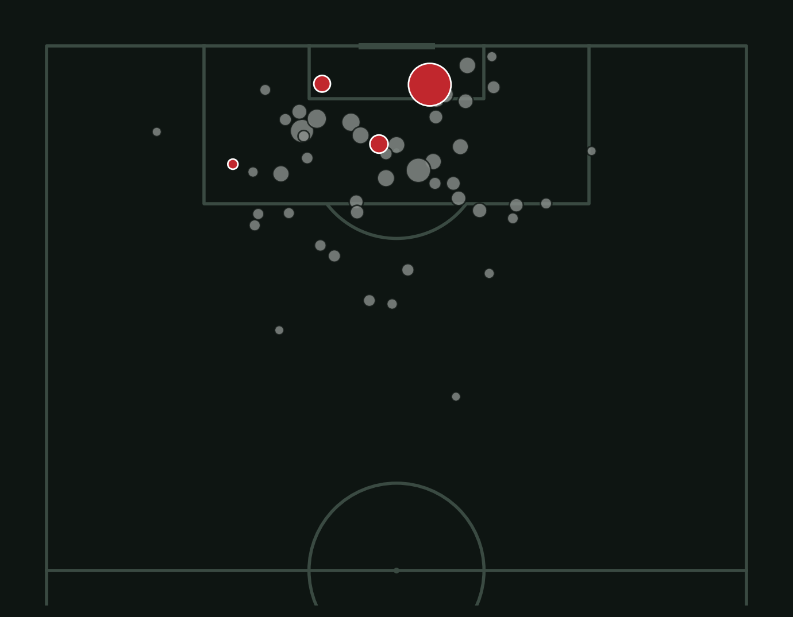

# How Did Morocco Reach the Semi-Final?

**Live site:** https://ryeggouti.github.io/morocco-world-cup-2022/

In 2022, Morocco became the first African team to reach a World Cup semi-final. I used free match data to understand how.

*All 70 shots Morocco's opponents took at the 2022 World Cup. Bigger circles were better chances; the 4 red ones went in.*

## Key findings
1. **Fewer shots, better chances.** Spain and Portugal out-shot Morocco (12 vs 6 and 12 vs 9), but Morocco had the higher expected goals (xG) in both matches: 0.57 vs 0.49 and 0.97 vs 0.74.
2. **Defending the box.** Knockout opponents often got into Morocco's box, but mostly for low-quality shots. Spain and Portugal took 24 shots combined and scored 0.
3. **Beating the odds.** En-Nesyri scored 2 goals from 1.05 xG, and Ziyech scored from 10 shots worth only 0.31 xG. As a team, Morocco scored 6 goals from 5.54 xG.
4. **Stronger when it got harder.** In the group stage, opponents' shots against Morocco were worth 0.13 xG each (28th of 32 teams). In the knockouts against Spain, Portugal, France and Croatia, that dropped to 0.08. Over all 7 matches (0.095), Morocco ranked 5th of the 8 teams that played 5+ matches, almost level with Argentina and England.

## Website features
- Shots / xG toggle on the match chart
- Interactive shot map: filter by match and tap any shot to see the player, minute, xG and outcome
- All numbers are calculated from the exported data, including penalty shootout results

## How I built it
- **Data:** StatsBomb Open Data (free event data for every 2022 World Cup match)
- **Analysis:** Python (pandas, matplotlib, mplsoccer) in Google Colab
- **Website:** HTML, CSS, JavaScript and Chart.js, hosted on GitHub Pages
- I used AI tools to help write some of the code. I chose the questions, checked the results, and wrote the findings.

## Data notes
- Penalty shootout kicks are excluded from shot and xG totals (Morocco beat Spain 3–0 on penalties after a 0–0 draw).
- StatsBomb credits the 72' goal vs Belgium to Romain Saïss; official records credit Abdelhamid Sabiri. The team total (6 goals) matches official results.
- Comparisons between teams are limited by sample size: teams played 3 to 7 matches against different opponents.

## License
Code: MIT. Match data: [StatsBomb Open Data](https://github.com/statsbomb/open-data), used under StatsBomb's own terms. Data credit: StatsBomb.

Part of **[Morocco in Data](https://ryeggouti.github.io/)**. See also:
[Is Morocco Running Out of Rain?](https://ryeggouti.github.io/morocco-drought/) · [Stork Flight](https://ryeggouti.github.io/stork-flight/)
